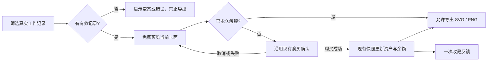

# 码迹AI · React Bits 动效应用设计

日期：2026-11-11

状态：两批方案已实施；本地验证与交付记录见 [运行验证](../.ai_state/sprints/reactbits-motion/runtime-verify.md)

依据：当前 `dev` 工作区代码、React Bits Pro 公开预览和当前组件文档。

## 1. 推荐方案

**沿用码迹AI现有的黑银材质和绿色强调色，把动效集中在“操作反馈、状态变化、成果展示”三处。工作纪念卡作为最有辨识度的展示点，日报主流程保持快速、稳定。**

第一批优先做工作纪念卡的轻量 3D 预览、工坊商品的材质反馈、日报生成与发布的状态反馈。后续再统一欢迎页、动态消息和成长页面的动画节奏。

实现采用现有 Vue、CSS 和原生 Pointer Events。将仓库已有的卡片倾斜逻辑收敛为一份共享实现，其他效果就近放进已有样式和组件。目标是零新增运行时依赖，不建立独立动效引擎。

用户已确认实施以下两批范围。本文保留设计目标，实际覆盖情况与验证限制以运行验证记录为准。

## 2. 当前项目实际情况

| 已有能力 | 当前代码依据 | 对设计的影响 |
| --- | --- | --- |
| Vue + Electron，Element Plus 控件，SCSS 样式；已有 ECharts 和 Three.js | [package.json](../package.json)、[渲染入口](../src/renderer/src/main.ts) | React 组件不能直接作为 Vue 组件使用；保留当前控件体系 |
| 浅色为白银材质、深色为黑银材质；绿色用于主要操作和选中状态 | [主题变量](../src/renderer/src/styles/_theme.scss)、[材质样式](../src/renderer/src/styles/_atelier.scss) | 新动效沿用主题变量，避免引入另一套彩色科技风 |
| 页面懒加载，离场立即完成，新页面仅做 80ms 淡入 | [App.vue](../src/renderer/src/App.vue)、[页面切换样式](../src/renderer/src/styles/_shell.scss) | 保留现有切换速度，不增加离场等待和整页位移 |
| 日报范围区已有纸张叠层、鼠标倾斜，以及 5 秒循环悬浮 | [ReportSetupCard.vue](../src/renderer/src/components/report-generate/ReportSetupCard.vue)、[日报样式](../src/renderer/src/styles/_report.scss) | 复用倾斜实现；将主业务页常驻悬浮收敛为用户触发的反馈 |
| 工作纪念卡已有三款 SVG 卡面、真实数据筛选、永久解锁、SVG / PNG 导出 | [WorkMemoryCards.vue](../src/renderer/src/components/rewards/WorkMemoryCards.vue)、[卡面生成器](../src/shared/workMemoryCard.ts) | 增强现有大预览，继续共用原始卡面和导出逻辑 |
| 工坊已有装扮、花园、纪念卡、专注空间、收支明细；交易返回统一快照 | [CoinWorkshopView.vue](../src/renderer/src/views/CoinWorkshopView.vue)、[工坊状态](../src/renderer/src/composables/useCoinWorkshop.ts) | 动画跟随真实购买结果，不新增资产、钱包或消费状态 |
| 顶栏钱包已有余额变化动画，签到与付费播放分别调用现有 IPC | [CheckinRewardCenter.vue](../src/renderer/src/components/rewards/CheckinRewardCenter.vue) | 优化现有余额反馈，不再叠加第二套数字动画 |
| 专注空间已有雨夜、咖啡馆、宇宙舱本地 SVG 动画；时间长河已有星点、节点移动和回放 | [FocusSpace.vue](../src/renderer/src/components/rewards/FocusSpace.vue)、[JiaziTimelineView.vue](../src/renderer/src/views/JiaziTimelineView.vue) | 以节奏统一和停播规则为主，不叠加新的全屏背景 |
| 签到特效已有粒子、Three.js 环境和独立演出层 | [RewardEffectOverlay.vue](../src/renderer/src/components/rewards/RewardEffectOverlay.vue)、[特效目录](../src/renderer/src/components/rewards/rewardEffects.ts) | 强烈演出继续留在用户主动选择的特效入口 |

### 2.1 参考站点的使用边界

本轮查看了 12 个组件的公开预览、说明和 Props，以及官方安装说明、许可证。Credit Card 的 Code 页当前显示付费解锁提示，未取得或阅读其受保护源码。

[官方安装说明](https://pro.reactbits.dev/docs/installation)要求 React 项目和 shadcn/ui，提供 Tailwind / vanilla CSS 两种样式变体；CSS 变体也仍是 React 组件，不能直接安装成 Vue 组件。

**本方案借鉴公开演示的视觉方向，独立实现项目需要的通用交互，不依赖获取 Pro 源码，也不承诺逐像素复刻。** 如后续使用 Pro 源码，应先取得有效授权、阅读所用版本源码与依赖，并遵守[官方许可证](https://pro.reactbits.dev/license)：第 2.1 节规定开发者席位，第 2.4 节限制原始或修改后的产品源码在公开仓库等渠道分发。

## 3. 统一视觉与动效规则

### 3.1 保留现有视觉语言

- 浅色沿用 `--c-primary: #16815e`，深色沿用 `--c-primary: #b6f36a`；装扮强调色继续由现有主题提供。
- 卡片、区块和表单沿用当前圆角与尺寸：卡片 22px、区块 12px、常规控件 36px 高及 10px 圆角。
- 高光表现银质、纸张和已有卡面材质。绿色承担选择、可执行状态和成功反馈；错误继续使用现有语义色。
- 页面结构、筛选栏、编辑区和操作按钮保持稳定。动效不改变字号、行高和控件命中区域。

### 3.2 三种强度

| 层级 | 使用位置 | 设计参数 | 目的 |
| --- | --- | --- | --- |
| 操作反馈 | 按钮、Tabs、筛选、选中状态 | 80–120ms，颜色变化；允许轻微按压，文字和表单不位移 | 立即确认输入 |
| 状态反馈 | 生成、发布、购买、消息到达 | 160–180ms 淡入或颜色变化；新消息位移不超过 4px | 明确结果和当前进度 |
| 展示反馈 | 纪念卡大预览、商品插画、欢迎页 | 回正 240ms；纪念卡最大倾斜 ±5°；一次入场总时长不超过 300ms | 增强材质和成果感 |

页面切换继续使用已有的 **80ms** 淡入，不套用展示层参数。等待中的细流光可循环约 2.4 秒一轮，但只在真实任务执行期间出现。

日常业务页同一时刻最多突出一个持续运动的状态区域。成长页面沿用各自已有场景，重点控制运动范围和可停止性。

## 4. React Bits 组件与项目位置对应

以下均为已查看的实际组件。采用的是适合码迹AI的视觉特征，参数按第 3 节收敛，不直接照搬原站默认强度。

| 参考组件 | 原站实际效果 | 项目使用位置 | 采用方式 |
| --- | --- | --- | --- |
| [Credit Card](https://pro.reactbits.dev/docs/components/credit-card) | 悬停 3D 倾斜、视差、高光；带银行卡字段 | 工作纪念卡大预览 | **第一批重点**：保留现有工作卡面，只增加轻倾斜和材质高光 |
| [Depth Card](https://pro.reactbits.dev/docs/components/depth-card) | 指针驱动卡片深度、分层视差和聚光 | 工坊装扮预览、纪念卡缩略图 | 第一批：只让插画层轻微抬升和显亮，价格与按钮固定 |
| [Frame Border](https://pro.reactbits.dev/docs/components/frame-border) | 清晰发光边框、沿边流动的光线和交互脉冲 | 当前生成区域、发布状态区域 | 第一批：用 CSS 实现简化的细边状态光，不移植其 Canvas 光效 |
| [Card Spread](https://pro.reactbits.dev/docs/components/card-spread) | 扇形卡组在悬停时展开 | 日报范围区已有纸张叠层 | 只借鉴叠层关系，保留现有三层纸张，删除常驻漂浮；不增加扇形图库 |
| [Animated List](https://pro.reactbits.dev/docs/components/animated-list) | 新条目进入实时信息流 | 工作台最近同步记录、动态消息 | 第二批：仅为真实新增条目做短淡入，不使用演示自动添加数据 |
| [Staggered Text](https://pro.reactbits.dev/docs/components/staggered-text) | 按字、词或行错峰入场 | 首次欢迎页的短标题 | 第二批：按两段短句入场，总时长不超过 300ms；正文立即可读 |
| [Aurora Blur](https://pro.reactbits.dev/docs/components/aurora-blur) | 柔和、模糊的极光背景 | 欢迎页标题后的小面积氛围层 | 第二批：用本地渐变表达材质，短淡入后静止；专注空间保留已有插画 |
| [Simple Graph](https://pro.reactbits.dev/docs/components/simple-graph) | 平滑的折线绘制动画 | 工作台“近 7 天日报状态”图表 | 第二批：借鉴绘制节奏，在现有 ECharts 内调整，不替换图表实现 |
| [Modal Cards](https://pro.reactbits.dev/docs/components/modal-cards) | 卡片展开为全屏弹层 | 已有日报详情弹窗、历史详情抽屉 | 只借鉴入场与返回关系，继续使用现有 Element Plus 弹层，不增加全屏卡片变形 |

### 4.1 本轮不采用的效果

| 组件 | 实际效果 | 不采用的原因 |
| --- | --- | --- |
| [Chroma Card](https://pro.reactbits.dev/docs/components/chroma-card) | 图片倾斜、RGB 错位和像素扰动 | 会干扰卡面文字、价格和统计阅读；现有静态星轨材质已经足够 |
| [Text Morph](https://pro.reactbits.dev/docs/components/text-morph) | 单词逐字形变，共享字母滑动到新位置 | 日报正文、状态、余额需要完整且即时可读；无需维护另一套文字切换状态 |
| [Preloader](https://pro.reactbits.dev/docs/components/preloader) | 五种加载幕布、百分比和过场 | 项目已有启动占位与真实加载状态；不增加额外过场或模拟百分比 |

## 5. 重点交互设计

### 5.1 工作纪念卡：本次最值得做的展示点

当前“时光纸笺、工程蓝图、星轨纪念”已有独立插画。让用户在大预览中感到卡片可以拿在手上，同时保留原来的筛选、解锁和导出流程。

| 触发 | 画面变化 | 操作规则 |
| --- | --- | --- |
| 指针进入大预览 | 卡面按指针位置轻微倾斜，最大 ±5°；高光以低透明度出现 | 仅作用于预览图像，外层预览框和导出栏固定 |
| 指针移动 | 卡片连续跟随，最多按浏览器每帧更新一次 | 不等待上一段动画完成，不累计定时动画队列 |
| 指针离开或取消 | 240ms 回到正面，高光退出 | 快速重新进入可立即响应 |
| 切换卡面 | 新卡面短淡入，高光和角度回到初始状态 | 图片与筛选结果立即更新，连续选择以最后一次为准 |
| 解锁成功 | “已收藏”状态出现，卡片边缘做一次短高光 | 仅在现有购买接口成功返回后播放 |
| 点击导出 | 沿用现有导出中和下载提示 | 不把动画完成当作文件已经保存的证据 |

三款材质分别处理：纸笺使用暖色柔光，蓝图使用细银线反光，星轨使用已有卡面中的淡紫银色。只改变高光层，不给整个卡面加色偏或模糊。

卡面内容继续使用日期范围、累计提交、累计文件、涉及项目和里程碑。统计仍来源于已保存日报；不新增银行卡号、CVV、有效期或虚构成就。

**预览动效与导出卡面分离**：已有 SVG 是内容来源；倾斜、阴影和高光放在预览外层。SVG / PNG 导出保持正面、清晰，继续调用同一个卡面生成器。



图中动画只消费结果，不控制扣币、资产发放或导出权限。

### 5.2 工坊商品：增强展示，不移动操作区

- 装扮插画、纪念卡缩略图悬停时最多上移 2px，配合现有材质边缘和轻阴影。
- 商品名称、价格、购买按钮、余额不足提示保持固定且始终可见。
- 点击预览立即更新选择样式；未购买和已购买继续由现有 `ownedItemIds` 判断。
- 购买中沿用现有 `pending`；成功后播放一次局部高光，取消或失败维持原有资产状态。
- 钱包主卡借鉴 Credit Card 的银质表面，作为静态信息卡展示；余额不跟随指针倾斜。

### 5.3 日报生成与发布：让状态变化清楚可见

现有 `ReportEditorCard` 已接收 `loading`、`cancelling` 和草稿生成状态；`ReportPublishSidebar` 已接收 `pushing`、草稿发布状态与结果消息。直接从这些状态派生样式。

| 实际状态 | 动效与文字 | 行为 |
| --- | --- | --- |
| 准备就绪 | 当前阶段边缘轻微显亮，保留准备条件文字 | 不循环闪烁 |
| 生成或发布中 | 当前区域一条细流光，保留按钮 Loading 和实际项目状态 | 沿用已有取消入口和业务禁用规则，不额外等待动画 |
| 生成成功 | 停止流光；状态图标与提示短淡入 | 正文一次完整进入编辑器，不模拟打字 |
| 发布成功 | 停止流光；现有发布状态变为成功色 | 以接口结果为依据，不以点击动作或动画时长推断成功 |
| 失败或取消 | 停止流光；保留错误原因、已完成内容和重试操作 | 不震动整张表单，不播放成功反馈 |

范围区现有纸张叠层保留；取消 `report-deck-float` 的常驻循环，将指针倾斜强度收敛到约 ±4°。执行任务时不让这个装饰与当前状态流光同时争夺注意力。

素材日报、批量补日报先保留现有行为；第二批统一状态色和短反馈，不复制生成页面的状态管理。

### 5.4 钱包与业务数据：真实数值优先

- 顶栏钱包复用现有余额变化入口，把现有约 460ms 弹出收敛为 180ms 局部显亮。
- 接口返回后立即显示真实余额，使用等宽数字；不从零滚动计数，不展示过渡余额。
- 签到仅在 `rewardCoins > 0` 时展示到账反馈；重复签到保持现有“今天已经签到过了”提示。
- 工作台统计同样直接显示真实结果，可让数字容器短淡入，表格和账本保持静态。
- 新同步消息按现有记录 ID 做一次短淡入；首次读取、筛选、翻页和整批刷新不逐条重播。

### 5.5 欢迎页：短入场，立即能用

保留现有“仓库、汇报人、AI”准备项和“进入工作台”按钮，只在短标题使用两段错峰入场。

标题后的小面积银绿渐变在 300ms 内出现后保持静止。配置检查和按钮自始可操作，不把入场完成作为进入应用的条件。

是否显示欢迎页继续由现有启动偏好决定，不增加新开关，也不把欢迎页开关用作全局动效开关。

### 5.6 时间长河与专注空间：整理已有动效

- 时间长河继续使用原有节点、回放和热力图；选中节点的强调限制在节点附近，正文详情保持清晰。
- 不在时间长河上叠加新的极光、粒子海、卡片扇形排列或第二套时间回放。
- 专注空间保留三幅本地插画和已有雨丝、热气、星光；统一场景切换淡入，缩略图继续静态展示。
- 页面不可见时停止装饰动画，返回后恢复；**专注计时仍由当前应用层计时逻辑运行**，视觉停播不能暂停计时。
- 用户主动选择的签到演出继续使用现有入口、定价、关闭按钮和演出引擎，本设计不改动特效经济规则。

## 6. 最小实现与代码收敛

### 6.1 只提取一份已有的卡片倾斜逻辑

目前 `ReportSetupCard.vue` 中的 `tiltReportDeck` / `resetReportDeck` 已经通过 Pointer Events 设置 CSS 变量。第一批把它迁入一个小型 `useCardTilt.ts`，供日报纸张和纪念卡大预览共同使用，并删除组件内被替代的旧函数。

共享实现只负责指针位置、角度限制、每帧合并更新、离开复位及减少动态效果时停止。业务状态、卡面数据、购买、导出和元素内容仍由原组件管理。

其他边缘高光、短淡入和按压反馈放在已有 SCSS 或组件样式中。仅在 `_theme.scss` 增加少量统一时长变量，继续使用 `_tools.scss` 的 `reduced-motion` mixin。

### 6.2 文件影响范围

| 文件 | 第一批计划修改 |
| --- | --- |
| `src/renderer/src/composables/useCardTilt.ts`（拟新增） | 承接现有倾斜逻辑，两处共用；不提供通用动画编排 API |
| [WorkMemoryCards.vue](../src/renderer/src/components/rewards/WorkMemoryCards.vue) | 大预览倾斜、高光、卡面切换与收藏反馈；保留导出调用链 |
| [ReportSetupCard.vue](../src/renderer/src/components/report-generate/ReportSetupCard.vue) | 接入共享倾斜，删除旧局部实现 |
| [日报样式](../src/renderer/src/styles/_report.scss) | 移除常驻纸张漂浮，添加受业务状态约束的细边反馈 |
| [ReportEditorCard.vue](../src/renderer/src/components/report-generate/ReportEditorCard.vue)、[ReportPublishSidebar.vue](../src/renderer/src/components/report-generate/ReportPublishSidebar.vue) | 使用已有状态绑定样式，不新增业务状态机 |
| [CoinWorkshopView.vue](../src/renderer/src/views/CoinWorkshopView.vue) | 商品插画反馈、静态钱包材质与购买成功反馈 |
| [CheckinRewardCenter.vue](../src/renderer/src/components/rewards/CheckinRewardCenter.vue) | 收敛现有余额动画，继续使用同一钱包快照 |
| [主题变量](../src/renderer/src/styles/_theme.scss) | 少量统一时长变量；已有尺寸、颜色、主题来源不变 |

第一批影响限定在 renderer。数据库、IPC、AI 请求、飞书协议、商品目录、价格和权限模型不在修改范围内。

不新增 React、shadcn/ui、Tailwind、Motion 或 GSAP；不新增通用 `MotionCard` 包装层、动画注册表、动效配置面板和另一套 Canvas / WebGL 引擎。

第二批修改欢迎页、动态消息和已有成长页面时，继续在原组件内收敛，不建立与本文件并行的第二套方案。

## 7. 性能、操作与无障碍要求

1. `prefers-reduced-motion: reduce` 下停用倾斜、位移、错峰、连续流光和场景运动；状态、真实数值和操作立即显示。
2. 倾斜仅在支持精细指针悬停的环境启用；触摸和键盘使用稳定卡面、选中边框和清晰焦点。
3. 同一帧合并指针更新；动画优先修改 `transform` 和 `opacity`，避免逐帧更新 Vue 业务状态、布局尺寸或大型阴影。
4. 卡面倾斜放在图像层，购买和导出按钮不进入变换层；高光层设置 `pointer-events: none`。
5. 动画可以随新的输入立即停止或改向，不能锁住页面导航、取消、重试或正常编辑。
6. 元素卸载后清理帧任务和监听；不可见的装饰区域停止播放。不得用视觉生命周期控制专注计时或后台业务任务。
7. 不让全局容器为了动效新增 `transform` 或裁剪，避免改变弹层定位和堆叠关系；已有弹窗继续挂载到 body。
8. 核心文本始终有完整可读内容。屏幕阅读器播报业务状态，不播报每一帧数值或装饰字符。
9. 项目中的图表参数及 Element Plus 弹层调整，应在实施时核对当前安装版本文档与源码；本设计不假定 Pro 组件内部依赖或接口实现。

以上为验收目标。本地已核对生产依赖闭包及改动前后体积；未测得可用于承诺的稳定帧率，详见运行验证记录。

## 8. 实施顺序与验收

### 第一批：完成核心展示与业务反馈

按顺序完成共享倾斜收敛、纪念卡预览、商品插画反馈、生成/发布状态、钱包余额反馈。以工作纪念卡为主要视觉验收场景，报告主流程为性能与操作回归场景。

验收重点：

- 三款纪念卡都可预览；筛选、无记录、错误、未解锁与导出中状态正确；连续移动和快速切换不残留角度。
- 倾斜与高光不进入导出的 SVG / PNG，不移动操作按钮，不改变卡面统计口径。
- 购买取消、余额不足、失败和重复购买沿用原结果，只有真实成功播放收藏反馈。
- 生成、取消、失败、发布、保存和复制均维持原有操作闭环；正文可立即阅读与编辑。
- 页面切换保持 80ms 淡入，离场立即完成；新增轻动效不把 Three.js / ECharts 拉入日报首屏。
- 浅色、深色和已装备主题下可读；至少检查 1366×768、1440×900 和 1024×640，以及当前页面缩放操作。
- 系统减少动态效果、键盘操作、窗口最小化/恢复和弹窗层级均通过实际检查。

实施后的重点自动验证沿用现有入口：

```powershell
npm run test:coins
npm run test:reliability
npm run test:e2e -- tests/e2e/work-memory-cards.spec.ts tests/e2e/coin-workshop.spec.ts tests/e2e/reports.spec.ts tests/e2e/startup.spec.ts tests/e2e/repository-projects.spec.ts
npm run check
git diff --check
```

仅为新动效补充必要的集成断言，例如减少动态效果时停止、卸载清理、导出内容未受影响；不为每条 CSS 或每个动画时长新增镜像单测。静态 CSS 渲染效果通过实际截图和交互检查验收。

### 第二批：统一其余页面节奏

完成欢迎页短入场、真实消息条目淡入、已有 ECharts 绘制节奏，以及时间长河/专注场景的停播和切换规则。优先整理当前动画，保持成长场景自身的视觉特点。

### 本轮交付与证据边界

设计阶段完成当前代码位置核对、12 个参考组件的公开预览与文档查看，以及安装要求和许可证核对。实施阶段已落地两批 renderer 动效，共享倾斜、即时真实状态、预览/导出分离与装饰停播。

本地工坊单测、可靠性测试、浏览器回归、类型/构建与真实隔离 Electron 验证通过。未新增依赖或修改数据库、IPC、AI/飞书协议、商品价格；未执行线上发布或可见安装包验收。具体命令、截图和限制见运行验证记录。
